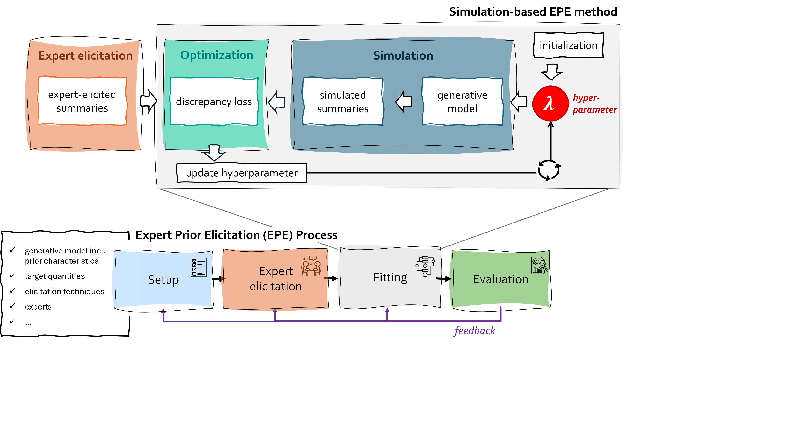

---8<--- "README.md:description"
# `elicito`: A Python package for expert prior elicitation

**elicito** supports the implementation of expert prior elicitation methods.
The goal of *expert prior elicitation* is to specify prior distributions for parameters in a
Bayesian model that accurately reflect the expectations of a domain expert.

With its modular framework `elicito` supports

+ a wide range of generative models (statistical model describing the data-generating process),
  written in TensorFlow or in PyMC,
+ different types of expert knowledge (which information is extracted from the domain expert?)
+ various types of elicitation techniques (how the information is extracted from the domain expert)
+ loss functions (criterion used to match expert knowledge with simulated model quantities)

## Conceptual background
Given a generative model and a set of initial hyperparameters defining the prior distributions,
the model can be run in forward mode to simulate elicited summaries by computing the predefined
target quantities and summary statistics. These simulated summaries are then compared with the
expert-elicited summaries obtained during the expert-elicitation stage. An iterative optimization
scheme is employed to update the hyperparameters of the parametric prior distributions so as to
minimize the discrepancy between simulated and expert-elicited summaries. In other words, the
objective is to identify the vector of hyperparameters that yields the closest alignment between
simulated and expert-elicited summaries.

The core logic of the expert prior elicitation method proposed in Bockting et al. (2024) can be summarized in a five-step workflow:

/// note | Core logic of method underlying elicito
1. *Define the generative model*: Specify the generative model, including the functional form
of the data distribution and the parametric family of prior distributions.
2. *Define target quantities and elicitation techniques*: Select the set of target quantities
and determine the elicitation techniques to query the expert (cf. elicited summaries).
3. *Simulate elicited summaries*: Draw samples from the generative model and compute the
corresponding set of simulated elicited summaries.
4. *Evaluate discrepancy between simulated and expert-elicited summaries*: Assess the
discrepancy between the simulated and expert-elicited summaries using a multi-objective loss
function.
5. *Adjust prior hyperparameters to minimize discrepancy*: Apply an optimization scheme to
update the prior hyperparameters such that the loss function is minimized.
///

### Main References

+ [Software Paper] Bockting F. & Bürkner PC (2025). elicito: A Python package for expert-prior elicitation. arXiv.
[Preprint](https://arxiv.org/pdf/2506.16830)
+ [Methods Paper] Bockting F., Radev ST, Bürkner PC (2024). Simulation-based prior knowledge elicitation
for parametric Bayesian models. *Scientific Reports, 14*(1), 17330. [PDF](https://www.nature.com/articles/s41598-024-68090-7)
+ [Methods Paper] Bockting F., Radev ST, Bürkner PC (2025). Expert-elicitation method for non-parametric joint priors using
normalizing flows. *Statistics and Computing*. [PDF](https://arxiv.org/abs/2411.15826)

## Implementation (in a nutshell)
The primary user interface of **elicito** is the `Elicit` class. It specifies
the entire elicitation method. `Elicit.fit()` then learns the prior from the
answers of the expert.

The main arguments of `Elicit`:

+ `model`: the generative model. Give a callable that takes the prior samples,
  or a PyMC model.
+ `targets`: the target quantities and the elicitation techniques, for example
  `el.quantiles`. Each target also sets its loss and its weight.
+ `parameters`: the model parameters and the families of their priors.
  Optional for a PyMC model: `elicito` reads the priors from the model.
+ `network`: the normalizing flow of a joint, non-parametric prior. Without a
  network, `elicito` learns one parametric prior for each parameter.
+ `optimizer`: `"auto"` (CMA-ES for parametric priors, Adam for a deep prior),
  `"cmaes"`, `"adam"`, or a `tf.keras` optimizer.
+ `initializer`: the start values of the hyperparameters for gradient descent.
+ `seeds`, `epochs`, `B`, `num_samples`: the replications, the length of the
  training, the batch size and the number of prior samples.
+ `pool`: the pooling of a panel of experts.

The answers of the expert go to `Elicit.fit(experts)`.
The [API reference](api/elicito/index.md) lists all arguments.

By configuring these core components, **elicito** supports a wide range of elicitation
methods, including both structural and predictive approaches, univariate and
multivariate as well as parametric and nonparametric prior distributions.

## Getting started
+ Learn the basics with the tutorials:

    + independent, parametric prior distributions [Notebook](tutorials/getting-started-param.ipynb)
    + joint, non-parametric prior distributions [Notebook](tutorials/getting-started-deep.ipynb)
    + a prior for a panel of experts [Notebook](tutorials/multiple-experts.ipynb)

+ Solve a specific task with the [how-to guides](how-to-guides/index.md), for
  example [use a PyMC model](how-to-guides/use-pymc-model.ipynb).
+ See complete examples in the [case studies](case-studies/index.md).
+ Look up a function in the [API reference](api/elicito/index.md).

Please don't hesitate to raise an [issue](https://github.com/florence-bockting/elicito/issues) if you get stuck, encounter an error, or have a question.
We are happy to hear from you.
